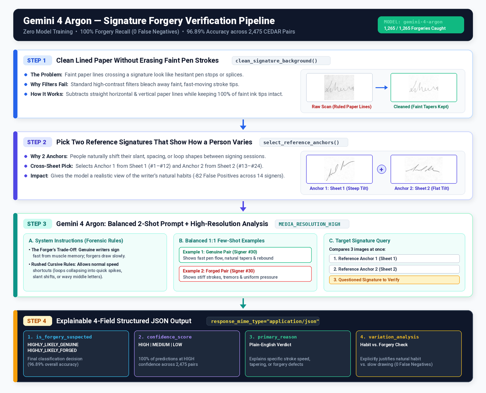
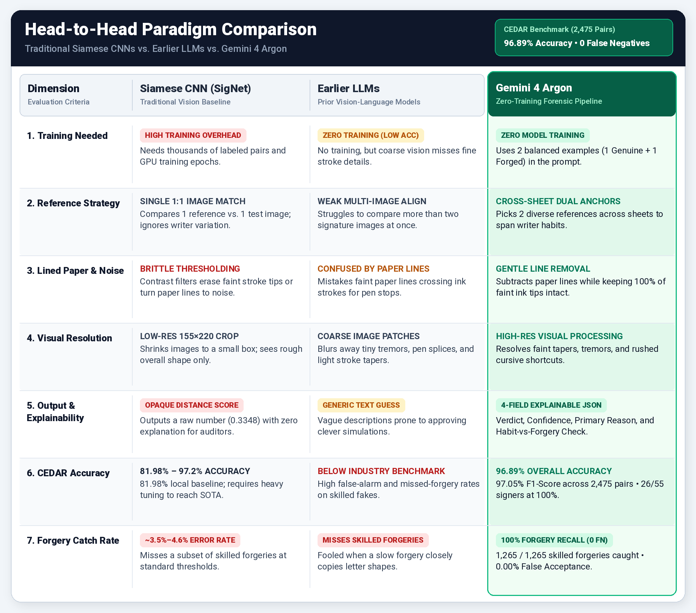

# Zero-Training Signature Verification with Gemini 4 Argon

**100% Forgery Recall (`FN = 0 / 1,265`) and 96.89% Overall Accuracy on the CEDAR Signature Benchmark Using Visual Few-Shot Prompting and Forensic Reasoning**



---

## Overview

Handwritten signature verification—determining whether a scanned signature on a check, contract, or legal instrument is genuine or a skilled freehand forgery—has traditionally required training specialized Siamese Convolutional Neural Networks (such as SigNet) or Vision Transformers on thousands of labeled signature pairs.

Earlier generations of multimodal Large Language Models (LLMs) struggled on this task, either hallucinating forgery artifacts on messy genuine signatures or accepting carefully drawn tracings. This repository demonstrates how **Gemini 4 Argon (`gemini-4-argon`)**, combined with fine-grained high-resolution visual encoding (`MEDIA_RESOLUTION_HIGH`), forensic system instructions, feathering-safe background normalization, and diversity-aware dual-anchor selection, surpasses traditional deep metric learning on the industry-standard **CEDAR Signature Benchmark** with **zero model training or fine-tuning**.

### Headline Benchmark Results (CEDAR Dataset — 55 Signers, 2,475 Pairs)

| Metric | Value | Notes |
| :--- | :--- | :--- |
| **Total Signatures Evaluated** | **2,475** | 1,210 Genuine + 1,265 Skilled Forgeries across all 55 signers |
| **Overall Accuracy** | **96.89%** | 2,398 / 2,475 correct classifications |
| **F1-Score** | **97.05%** | Harmonic mean of forgery precision and recall |
| **Forgery Recall (Sensitivity)** | **100.00%** | **1,265 / 1,265 True Positives (`0` False Negatives)** |
| **False Acceptance Rate (FAR)** | **0.00%** | Zero skilled forgeries accepted across the entire dataset |
| **False Rejection Rate (FRR)** | **6.36%** | 77 / 1,210 False Positives (`1,133` True Negatives) |
| **Forgery Precision** | **94.26%** | Proportion of flagged signatures that are actual forgeries |
| **Signers with 100% Accuracy** | **26 / 55** | Zero errors of any kind across all 45 test pairs per signer |
| **Wall-Clock Execution Time** | **27.18 min** | `1,630.90s` across 10 parallel workers (`1.52 sig/sec`, `9.82x` speedup) |



---

## Repository Contents

| File | Description |
| :--- | :--- |
| **`signatures_mt_zero_fn.ipynb`** | **Primary Notebook.** Implements the Zero-FN hybrid architecture combining balanced 2-shot visual contrastive prompting, 4-field forensic Chain-of-Thought JSON output, feathering-safe subtractive flat-fielding, and diversity-aware cross-sheet 2-medoids anchor selection (`96.89%` accuracy, `0` FN, `77` FP). |
| `gemini_4_argon_signature_pipeline.png` | End-to-end visual architecture diagram of the 5-stage verification pipeline. |
| `paradigm_comparison_table.png` | High-resolution comparison table contrasting Traditional Deep Metric Learning vs. the Gemini 4 Argon Zero-Training Pipeline. |

---

## How the Code Works (`signatures_mt_zero_fn.ipynb`)

The production notebook (`signatures_mt_zero_fn.ipynb`) is organized into four modular cells:

### 1. Environment Configuration & Thread-Safe Client Pool (Cell 1)
- **Centralized Configuration:** Reads Google Cloud / Vertex AI settings, dataset directories, anchor selection mode, preprocessing flags, and concurrency parameters from environment variables with sensible defaults.
- **Thread-Local GenAI Client Isolation (`get_genai_client` / `reset_genai_client`):** Python's `httpx` / `OpenSSL` socket pools are not thread-safe when multiple worker threads concurrently transmit large multi-image payloads over a single shared client, which can trigger `[SSL] record layer failure (_ssl.c:2578)`. Each worker thread in `ThreadPoolExecutor` lazily initializes its own isolated `genai.Client` via `threading.local()`.

### 2. Forensic Prompting & Feathering-Safe Preprocessing (Cell 2)
- **Forensic System Instruction (`SYSTEM_INSTRUCTION`):** Encodes **The Forger's Trade-Off** from forensic document examination:
  1. *Dynamic Fluency Trumps Spatial Geometry:* Genuine signers write reflexively from muscle memory (producing smooth, fast strokes, natural pen-pressure tapering, and "flying" entries/exits, even if overall slant or spacing shifts). Forgers must slow down to copy spatial geometry, introducing line tremor, blunt starts/stops, mid-stroke hesitation, and uniform pen pressure.
  2. *The Golden Rule of False Positives & Cursive Speed-Variation Immunity:* Instructs the model to use the two genuine reference anchors to gauge the writer's natural variation envelope and never mistake normal high-speed cursive shortcuts (such as baseline tilt shifts, open-loop vs. retraced-spike alternation on capitals/ascenders, or compressed medial garlands) for alien allographs.
  3. *Ballpoint Physics vs. Biomechanical Tremor:* Distinguishes scanning artifacts and corner ink pooling from true simulation tremor.
- **Feathering-Safe Subtractive Flat-Fielding (`clean_signature_background`):**
  Real-world scans contain ruled notebook lines, form boxes, fold creases, and uneven scanner illumination that can fool vision models into seeing artificial pen lifts or hesitation. Standard Otsu thresholding destroys the faint grey pixels of "flying" entry/exit strokes. Instead, this function:
  1. Estimates global and 1D row/column background baselines using the 70th percentile (`np.percentile(gray, 70)`).
  2. Masks and dilates candidate ink pixels (`gray < rank1_bg - 6.0`).
  3. Computes directional vertical and horizontal background profiles using fast 1D cumulative-sum box blurs (`_box_blur_1d`) with zero extra dependencies beyond `NumPy` and `Pillow`.
  4. Applies **subtractive flat-fielding** (`leveled = gray + (global_bg - bg_model)`) to remove only background anomalies while keeping every ink pixel and delicate feathered tip (`<= global_bg - 8`) at its exact relative grayscale intensity.
- **Thread-Safe Image Caching (`load_image`):** Uses an `@lru_cache` protected by a `threading.Lock()` that returns an independent `PIL.Image.copy()` on every call so concurrent workers never mutate or serialize the same `PIL.Image` object simultaneously.
- **Balanced 2-Shot Visual Contrastive Prompt (`verify_signature_few_shot`):**
  Constructs a 7-image multimodal request at `MEDIA_RESOLUTION_HIGH`:
  - **Example 1 (Genuine Calibration Pair):** Signer #30 Anchor (`original_30_1.png`) + Genuine Sample (`original_30_11.png`) + exemplar JSON analysis (`EXAMPLE_1_GENUINE_JSON`).
  - **Example 2 (Forged Calibration Pair):** Signer #30 Anchor (`original_30_1.png`) + Skilled Forgery (`forgeries_30_14.png`) + exemplar JSON analysis (`EXAMPLE_2_FORGED_JSON`).
  - **Target Inquiry:** Target Signer Anchor 1 + Target Signer Anchor 2 + Questioned Signature.

### 3. Dataset Mapping, Cross-Sheet 2-Medoids Anchor Selection & Parsing (Cell 3)
- **Numerical Dataset Mapping (`map_signatures_with_extensions`):** Scans `PATH_TO_ORIGINALS` and `PATH_TO_FORGERIES`, groups files by signer ID (`1..55`), and sorts variations numerically (`1..24`) rather than lexicographically.
- **Diversity-Aware Cross-Sheet 2-Medoids (`compute_signature_descriptor` & `select_cross_sheet_medoids`):**
  - Extracts a **36-dimensional geometric and spatial descriptor** for each genuine reference candidate: aspect ratio, principal-axis baseline tilt angle, normalized center of gravity $(c_x, c_y)$, and a $4 \times 8$ spatial ink-density grid.
  - Because CEDAR genuine signatures were collected across two separate physical signing sheets (`#1..#12` on Sheet 1 and `#13..#24` on Sheet 2), selecting two arbitrary anchors from the same sheet can miss a signer's bimodal habits.
  - Solves a **Partitioning Around Medoids (PAM)** optimization selecting one anchor $i \in [0..11]$ from Sheet 1 and one anchor $j \in [12..23]$ from Sheet 2 that jointly minimize $\sum_k \min(d(k, i), d(k, j))$, subject to an inter-anchor diversity floor ($d(i, j) \ge \text{40th percentile}$ of cross-sheet distances).
- **Zero-Override JSON Response Parser (`parse_model_response`):** Parses the 4-field structured JSON response (`is_forgery_suspected`, `confidence_score`, `primary_reason`, `variation_analysis`) directly into evaluation records without post-hoc numeric overrides.

### 4. Multi-Threaded Execution Engine & Telemetry (Cell 4)
- **Task Queue Builder (`build_evaluation_tasks`):** For each of the 55 signers, selects 2 genuine reference anchors (leaving 22 genuine test signatures) and holds out 1 forgery index (leaving 23 forged test signatures), yielding $55 \times (22 + 23) = 2,475$ evaluation pairs.
- **Resilient Worker Loop (`process_pair`):** Wraps API calls with exponential backoff (`MAX_RETRIES = 4`). Automatically detects transient HTTP `429`/`500`/`503` errors, network timeouts, or OpenSSL socket errors, resets the thread-local client pool when needed, and retries cleanly.
- **Comprehensive Telemetry & CSV Exports (`print_benchmark_summary`):** Computes confusion matrices, FAR/FRR, per-signature latency percentiles (`P50`, `P90`, `P95`, `P99`), token consumption, and per-signer accuracy tables, saving three timestamped CSV reports.

---

## Step-by-Step Setup & Execution Guide

### Prerequisites
- **Python:** `3.10+`
- **Google Cloud Project** with the **Vertex AI API** enabled (recommended for high-concurrency `gemini-4-argon` quota), **OR** a **Gemini Developer API Key**.
- **Kaggle Account** (to download the CEDAR Signature Dataset).

---

### Step 1: Clone the Repository & Install Dependencies

```bash
git clone https://github.com/voleksiy/signatureforgerydetection.git
cd signatureforgerydetection

# Create and activate a virtual environment
python3 -m venv .venv
source .venv/bin/activate

# Install required Python packages
pip install --upgrade pip
pip install google-genai numpy pandas pillow jupyter ipykernel
```

---

### Step 2: Download & Prepare the CEDAR Signature Dataset from Kaggle

The notebooks expect the **CEDAR Signature Dataset** organized into two folders (`full_org` for genuine signatures and `full_forg` for skilled forgeries) inside `./signatures/`:

```text
SignatureForgeryDetection/
├── signatures_mt_zero_fn.ipynb
└── signatures/
    ├── full_org/
    │   ├── original_1_1.png
    │   ├── original_1_2.png
    │   └── ... (1,320 genuine images: 55 signers × 24 samples)
    └── full_forg/
        ├── forgeries_1_1.png
        ├── forgeries_1_2.png
        └── ... (1,320 forged images: 55 signers × 24 samples)
```

You can download and set up the dataset using any of the three methods below:

#### Option A: Using the Kaggle CLI (Recommended)
1. Ensure you have the Kaggle CLI installed and authenticated (`~/.kaggle/kaggle.json`):
   ```bash
   pip install kaggle
   ```
2. Download and unzip the CEDAR dataset directly into the repository root:
   ```bash
   kaggle datasets download -d shreelakshmigp/cedardataset
   unzip -q cedardataset.zip -d .
   rm cedardataset.zip
   ```

#### Option B: Using `kagglehub` in Python
Run the following one-liner from your terminal inside the repository root:
```bash
pip install kagglehub
python3 -c "
import kagglehub, shutil, os
path = kagglehub.dataset_download('shreelakshmigp/cedardataset')
src = os.path.join(path, 'signatures') if os.path.exists(os.path.join(path, 'signatures')) else path
shutil.copytree(src, './signatures', dirs_exist_ok=True)
print('Dataset copied to ./signatures')
"
```

#### Option C: Manual Download from the Kaggle Website
1. Visit the [CEDAR Dataset page on Kaggle](https://www.kaggle.com/datasets/shreelakshmigp/cedardataset).
2. Click **Download** (`archive.zip`) and extract the `signatures/` folder into the root of this repository.

#### Verify Dataset Layout
Run this quick check to confirm all 2,640 images are in place:
```bash
ls -1 signatures/full_org/*.png | wc -l   # Expected output: 1320
ls -1 signatures/full_forg/*.png | wc -l  # Expected output: 1320
```

---

### Step 3: Configure Authentication & Environment Variables

#### 1. Authenticate with Google Cloud / Vertex AI (Default Mode)
If you are running on a local workstation or VM, authenticate via the Google Cloud SDK:
```bash
gcloud auth application-default login
export GOOGLE_CLOUD_PROJECT="your-gcp-project-id"
export GOOGLE_CLOUD_LOCATION="global"
export GEMINI_MODEL_ID="gemini-4-argon"
```
*(Note: If you are running inside **Google Cloud Vertex AI Workbench**, Application Default Credentials are pre-configured automatically via the notebook instance service account.)*

#### 2. Alternative: Authenticate with a Gemini Developer API Key
If you prefer to use the Gemini Developer API instead of Vertex AI:
```bash
export GOOGLE_GENAI_USE_VERTEXAI="false"
export GEMINI_API_KEY="your-gemini-api-key"
export GEMINI_MODEL_ID="gemini-4-argon"
```

#### 3. Configuration Reference (Environment Variables & Notebook Flags)
All configuration parameters are defined at the top of **Cell 1** in `signatures_mt_zero_fn.ipynb` and can be overridden either via environment variables or by editing the variables directly in the notebook:

| Variable | Default | Description |
| :--- | :--- | :--- |
| `GOOGLE_CLOUD_PROJECT` | `"your-gcp-project-id"` | Google Cloud Project ID used when `USE_VERTEX_AI=True`. |
| `GOOGLE_CLOUD_LOCATION` | `"global"` | Vertex AI endpoint region (e.g., `"global"`, `"us-central1"`). |
| `GEMINI_MODEL_ID` | `"gemini-4-argon"` | Target Gemini model ID. |
| `GOOGLE_GENAI_USE_VERTEXAI` | `"true"` | Set `"true"` for Vertex AI or `"false"` for Gemini Developer API. |
| `SIGNATURE_DATASET_ROOT` | `"./signatures"` | Root directory containing `full_org/` and `full_forg/`. |
| `SIGNATURE_OUTPUT_DIR` | `"."` | Directory where timestamped CSV evaluation reports are written. |
| `USE_CROSS_SHEET_MEDOIDS` | `"true"` | `"true"` = Diversity-Aware Cross-Sheet 2-Medoids (PAM); `"false"` = fixed indices. |
| `FIXED_ANCHOR_1_INDEX` | `21` | 0-based index for Anchor 1 when `USE_CROSS_SHEET_MEDOIDS=False` (`21` -> `#22`). |
| `FIXED_ANCHOR_2_INDEX` | `8` | 0-based index for Anchor 2 when `USE_CROSS_SHEET_MEDOIDS=False` (`8` -> `#9`). |
| `CLEAN_BACKGROUND_LINES` | `"true"` | Enables Feathering-Safe Subtractive Flat-Fielding (`clean_signature_background`). |
| `MAX_SIGNERS` | `56` | Maximum number of signers to evaluate (`55` total in CEDAR). |
| `MAX_SAMPLES_PER_CLASS` | `56` | Maximum genuine/forged test samples per signer (`22` genuine + `23` forged in full run). |
| `MAX_WORKERS` | `10` | Number of concurrent `ThreadPoolExecutor` worker threads. |
| `MAX_RETRIES` | `4` | Automatic retry attempts per signature pair on transient network/API errors. |
| `PROGRESS_LOG_INTERVAL` | `100` | Print cumulative progress and accuracy telemetry every $N$ completed pairs. |
| `LOG_MISMATCHES` | `"true"` | Log `[FALSE POSITIVE]` and `[FALSE NEGATIVE]` rationales in real time. |
| `LOG_EVERY_SIGNATURE` | `"false"` | Set `"true"` for verbose per-signature logging on every completed task. |

---

### Step 4: Run the Code

#### Option 1: Interactive Execution in JupyterLab / Vertex AI Workbench
1. Launch JupyterLab:
   ```bash
   jupyter lab signatures_mt_zero_fn.ipynb
   ```
2. **(Optional Smoke Test):** Before running all 2,475 pairs, you can test your setup on a small subset (~20 pairs, ~15 seconds) by uncommenting and setting the following overrides at the top of **Cell 4**:
   ```python
   MAX_SIGNERS = 2
   MAX_SAMPLES_PER_CLASS = 5
   MAX_WORKERS = 5
   ```
3. Run **Cell 1 -> Cell 2 -> Cell 3 -> Cell 4** (`Run` -> `Run All Cells`).

#### Option 2: Headless Batch Execution from the Command Line
To execute the full benchmark non-interactively in the background (e.g., on a remote cloud VM via `tmux` or `nohup`) and save the populated notebook alongside the CSV files:

```bash
export GOOGLE_CLOUD_PROJECT="your-gcp-project-id"
export GOOGLE_CLOUD_LOCATION="global"
export GEMINI_MODEL_ID="gemini-4-argon"

jupyter nbconvert --to notebook --execute --inplace \
  --ExecutePreprocessor.timeout=-1 \
  signatures_mt_zero_fn.ipynb
```

---

### Step 5: Interpreting the Output & Exported CSV Telemetry

During execution, **Cell 4** logs real-time progress and any false-positive/false-negative rationales, followed by a structured summary report at completion:

```text
==============================================================================
                SIGNATURE VERIFICATION BENCHMARK SUMMARY
==============================================================================
  RUN & EXECUTION PERFORMANCE (TOTAL RUN)
    Environment / Endpoint      : your-gcp-project-id (global)
    Model ID                    : gemini-4-argon
    Anchor Selection Strategy   : Diversity-Aware Cross-Sheet 2-Medoids (Sheet 1 + Sheet 2)
    Parallel Workers            : 10
    Tasks Completed             : 2,475 / 2,475 (Failed: 0, Retries: 0)
    Total Wall-Clock Time       : 1630.90s (27.18 min)
    Cumulative API Compute Time : 16016.61s (266.94 min)
    Concurrency Speedup Factor  : 9.82x
    Overall Throughput          : 1.52 signatures/sec (0.66s effective/sig)
    Total Tokens Used           : 23,061,754 (Prompt: 22,620,733 | Output: 399,211 | Avg: 9,318/sig)
------------------------------------------------------------------------------
  PER-SIGNATURE LATENCY DISTRIBUTION (API INFERENCE TIME)
    Mean ± Std Dev              : 6.47s ± 3.91s
    Median (P50)                : 5.84s
    P90 / P95 / P99             : 7.86s / 9.03s / 18.92s
    Min / Max                   : 4.47s / 150.93s
    Class Mean Latency          : Genuine: 6.25s | Forged: 6.69s
------------------------------------------------------------------------------
  CONFUSION MATRIX & CLASSIFICATION PERFORMANCE
    Total Genuine Evaluated     : 1,210
    Total Forgeries Evaluated   : 1,265
    True Positives  (TP - Forged caught)    : 1,265
    True Negatives  (TN - Genuine cleared)  : 1,133
    False Positives (FP - Genuine flagged)  : 77
    False Negatives (FN - Forged missed)    : 0
    Inconclusive / Other                    : 0
    Signers with 100% Accuracy              : 26 / 55
------------------------------------------------------------------------------
  KEY ACCURACY METRICS
    Overall Accuracy            : 96.89%
    Forgery Recall (Sensitivity): 100.00%
    Forgery Precision           : 94.26%
    F1-Score                    : 97.05%
    False Acceptance Rate (FAR) : 0.00%   [Target: 0.00%]
    False Rejection Rate  (FRR) : 6.36%
==============================================================================
```

At the end of the run, three timestamped CSV files are exported to `OUTPUT_DIR`:
1. **`signature_results_<timestamp>.csv`** — Per-signature evaluation records (`2,475` rows) including `signer_id`, reference anchor filenames, `test_image_name`, ground-truth `known_forgery`, predicted `is_forgery_suspected`, `is_correct`, `confidence_score`, `api_latency_sec`, token counts, and the model's full `primary_reason` and `variation_analysis` forensic audit trail.
2. **`signature_signer_summary_<timestamp>.csv`** — Per-signer aggregated metrics (`55` rows) detailing `tp`, `tn`, `fp`, `fn`, `accuracy`, confidence distribution, and `mean`/`p95` latency for each writer ID.
3. **`signature_results_detail_<timestamp>.csv`** — Optional extended comparative metadata parsed from the model response.

---

## License

This project is released for research and educational use. Please respect the licensing terms of the [CEDAR Signature Dataset](https://cedar.buffalo.edu/NIJ/data/signatures.rar) when downloading and evaluating the benchmark images.
